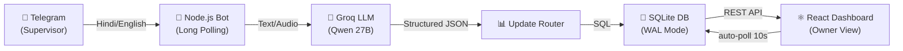

<div align="center">
  <h1>🏗️ SiteCommand (NirmanSetu)</h1>
  <p><strong>Enterprise-Grade Construction Site Management via AI & Telegram</strong></p>

  [](https://reactjs.org/)
  [](https://nodejs.org/)
  [](https://sqlite.org/)
  [](https://www.docker.com/)
  [](LICENSE)
</div>

<br/>

SiteCommand (NirmanSetu) bridges the gap between field supervisors and office management. It allows on-site supervisors to send unstructured updates (in Hindi, English, or Hinglish) via a Telegram Bot (text or voice notes). An advanced AI engine parses these updates and automatically manages attendance, material inventory, petty cash, and daily reports on a premium real-time React dashboard.

## ✨ Key Features

- **🗣️ Natural Language Processing:** Send messages like *"Sab hajir hain"* or *"50 bag cement aaya ABC dealer se"*.
- **🎙️ Voice Note Support:** Automatically transcribes and processes voice memos sent from noisy construction sites.
- **⚡ Real-Time Dashboard:** Auto-polling architecture ensures the owner's dashboard is always up-to-date within seconds.
- **🛡️ AI Hallucination Guards:** Built-in fuzzy matching prevents the AI from inventing unknown workers or materials.
- **🔄 Fallback Engine:** Implements exponential backoff and a model fallback chain (Qwen → GPT-OSS → Allam) for 99.9% uptime.
- **📊 Premium UI/UX:** Built with sleek micro-animations, skeleton loaders, and intuitive KPI metrics.

## 🏗️ Architecture



## 🛠️ Technology Stack

- **Frontend:** React 18, Vite, Lucide Icons, Custom CSS (Vanilla, highly optimized)
- **Backend:** Node.js, Express.js, `node-telegram-bot-api`
- **Database:** `better-sqlite3` (Configured with WAL mode & high-performance indexing)
- **AI/LLM:** Groq API (Configured with Fallback Chain)
- **Deployment:** Docker, Docker Compose

---

## 🚀 Getting Started (Local Development)

### 1. Prerequisites
- Node.js (v18 or higher)
- A Telegram Bot Token (from [@BotFather](https://t.me/botfather))
- A Groq API Key

### 2. Installation

Clone the repository and install dependencies:
```bash
git clone https://github.com/parthkharat20/NirmanSetu.git
cd NirmanSetu
npm install
```

### 3. Environment Setup

Copy the example environment file and fill in your credentials:
```bash
cp .env.example .env
```

Required `.env` variables:
```env
PORT=3001
GROQ_API_KEY=your_groq_api_key
TELEGRAM_BOT_TOKEN=your_telegram_bot_token
DASHBOARD_API_KEY=optional_secret_for_production
```

### 4. Database Initialization (Optional)

To seed the database with sample data (workers, materials, sites):
```bash
npm run db:seed
```

### 5. Start the Application

Run the dev script (starts both Vite frontend and Node backend concurrently):
```bash
npm run dev
```
- **Dashboard:** [http://localhost:5173](http://localhost:5173)
- **API Server:** [http://localhost:3001](http://localhost:3001)

---

## 🐳 Production Deployment (Docker)

SiteCommand is optimized for zero-downtime production deployment using Docker.

1. Ensure Docker and Docker Compose are installed on your VPS (AWS/DigitalOcean/etc.).
2. Clone the repository and configure your `.env` file.
3. Build and run in detached mode:
   ```bash
   docker-compose up -d --build
   ```
4. **Access the App:** The application will be running on `http://localhost:3001` (the Express server serves the static React build securely).
5. **View Logs:** `docker-compose logs -f`

---

## 📱 Using the Telegram Bot

1. Search for your Bot username in Telegram.
2. Send a message to register your Session ID.
3. The system owner must link your Telegram ID to a specific Construction Site in the database.
4. Once authorized, send commands:
   - **Attendance:** *"Ramesh absent baaki sab present"*
   - **Materials:** *"Kal 100 bag cement chahiye urgent"*
   - **Expenses:** *"500 rupaye chai nashta"*
   - **Progress:** *"First floor column casting complete"*

## 🔐 Security & Reliability

- **API Protection:** `/api` endpoints are secured via Bearer Token middleware in production.
- **User Validation:** Telegram commands are rejected unless the sender exists in the `wa_sessions` table.
- **Audit Trails:** Every message and AI extraction result is logged in the `activity_log` table for complete transparency.

---
<div align="center">
  <i>Built for the future of Indian Construction Management.</i>
</div>
